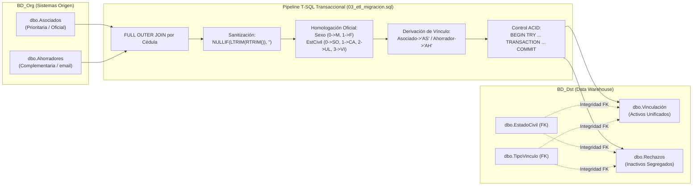
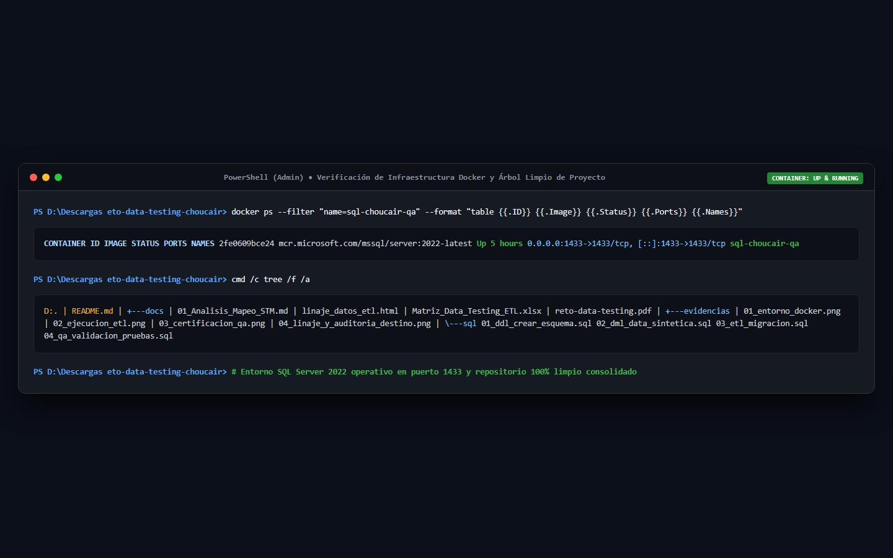
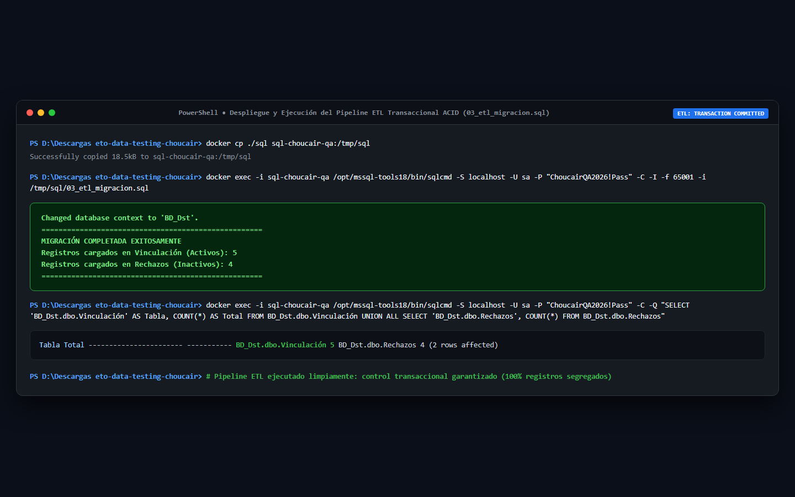
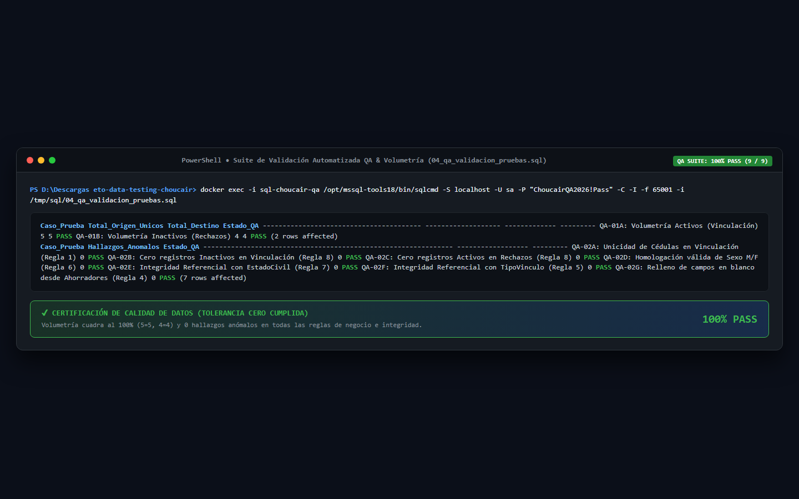
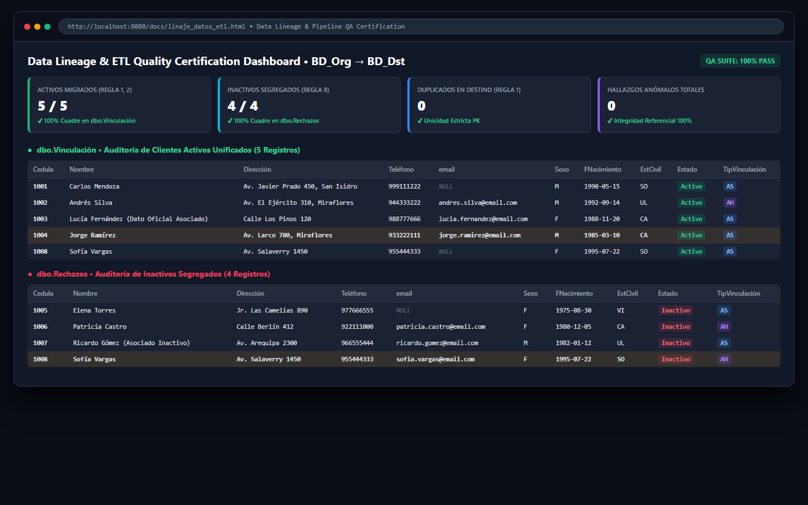

# 🚀 Reto Técnico Data Testing & DevOps - Pipeline ETL SQL Server

[](https://www.microsoft.com/sql-server)
[](https://www.docker.com/)
[](#-certificaci%C3%B3n-de-calidad-de-datos-qa-suite)
[](#-dashboard-interactivo-de-linaje-de-datos-data-lineage)
[](docs/Informe_Final_Data_Testing.md)

Solución integral y automatizada para el **Reto Técnico de Data Testing (Choucair Cárdenas Testing)**. Implementa un pipeline ETL transaccional en **Transact-SQL (T-SQL)** sobre un contenedor Dockerizado de SQL Server 2022, migrando y homologando datos de dos fuentes heterogéneas (`BD_Org.dbo.Asociados` y `BD_Org.dbo.Ahorradores`) hacia un modelo unificado en destino (`BD_Dst.dbo.Vinculación` y `BD_Dst.dbo.Rechazos`), validado al 100% mediante una suite automatizada de pruebas de volumetría, integridad y calidad de datos.

---

## 📁 Estructura del Repositorio y Entregables

El repositorio está organizado bajo estándares de ingeniería y DevOps:

```text
reto-data-testing-choucair/
├── docs/
│   ├── 01_Analisis_Mapeo_STM.md          # Matriz Source-to-Target Mapping (STM) y supuestos técnicos
│   ├── Informe_Final_Data_Testing.md     # Informe ejecutivo y técnico consolidado con evidencias
│   ├── linaje_datos_etl.html             # Dashboard interactivo autónomo de linaje y auditoría
│   ├── Matriz_Data_Testing_ETL.xlsx      # Libro Excel auditado con KPIs, STM y 17 Casos de Prueba QA
│   └── reto-data-testing.pdf             # Especificación técnica oficial del reto
├── evidencias/
│   ├── 01_entorno_docker.png             # Captura del contenedor activo y árbol de carpetas limpio
│   ├── 02_ejecucion_etl.png              # Captura de ejecución exitosa del pipeline transaccional T-SQL
│   ├── 03_certificacion_qa.png           # Captura de la suite de pruebas QA (100% PASS, 0 hallazgos)
│   └── 04_linaje_y_auditoria_destino.png # Captura del dashboard web y auditoría final de datos
├── sql/
│   ├── 01_ddl_crear_esquema.sql           # Creación de BDs (BD_Org, BD_Dst), tablas y catálogos FK
│   ├── 02_dml_data_sintetica.sql          # Dataset sintético controlado con casos borde (1001 a 1008)
│   ├── 03_etl_migracion.sql               # Pipeline ETL transaccional ACID (Reglas 1 a 8)
│   └── 04_qa_validacion_pruebas.sql       # Suite de pruebas automatizadas (QA-01 y QA-02)
└── README.md                             # Documentación maestra del proyecto
```

---

## 🏗️ Arquitectura de la Solución



---

## ⚙️ Guía de Despliegue y Ejecución Rápida (DevOps)

### 1. Desplegar el Contenedor Docker `sql-choucair-qa`
Si el contenedor aún no está en ejecución, inícialo con la siguiente instrucción:

```powershell
docker run -e "ACCEPT_EULA=Y" -e "MSSQL_SA_PASSWORD=ChoucairQA2026!Pass" -p 1433:1433 --name sql-choucair-qa -d mcr.microsoft.com/mssql/server:2022-latest
```

### 2. Copiar los Scripts SQL al Contenedor
Copia la carpeta `./sql` dentro de la ruta temporal del contenedor:

```powershell
docker cp ./sql sql-choucair-qa:/tmp/sql
```

### 3. Ejecutar la Cadena de Scripts en Secuencia
Ejecuta secuencialmente los scripts con `sqlcmd` asegurando los flags `-f 65001` (codificación UTF-8 para soporte de tildes: `Dirección`, `Teléfono`, `Vinculación`, `TipVinculación`) e `-I` (identificadores entrecomillados):

```powershell
# 1. DDL: Creación de bases de datos, tablas y llaves foráneas
docker exec -i sql-choucair-qa /opt/mssql-tools18/bin/sqlcmd -S localhost -U sa -P "ChoucairQA2026!Pass" -C -I -f 65001 -i /tmp/sql/01_ddl_crear_esquema.sql

# 2. DML: Carga de dataset sintético controlado (1001 a 1008)
docker exec -i sql-choucair-qa /opt/mssql-tools18/bin/sqlcmd -S localhost -U sa -P "ChoucairQA2026!Pass" -C -I -f 65001 -i /tmp/sql/02_dml_data_sintetica.sql

# 3. ETL: Ejecución del pipeline de migración transaccional
docker exec -i sql-choucair-qa /opt/mssql-tools18/bin/sqlcmd -S localhost -U sa -P "ChoucairQA2026!Pass" -C -I -f 65001 -i /tmp/sql/03_etl_migracion.sql

# 4. QA: Ejecución de la suite de aserciones de calidad y auditoría
docker exec -i sql-choucair-qa /opt/mssql-tools18/bin/sqlcmd -S localhost -U sa -P "ChoucairQA2026!Pass" -C -I -f 65001 -i /tmp/sql/04_qa_validacion_pruebas.sql
```

---

## 📋 Matriz de Reglas de Negocio Implementadas

| Regla | Descripción de la Especificación Oficial | Expresión Transact-SQL Implementada |
| :---: | :--- | :--- |
| **1 y 2** | Unificación por persona (máx 1 registro en destino) | `COALESCE(aso.Cedula, aho.Cedula)` en `FULL OUTER JOIN` |
| **3** | Prevalencia de datos oficiales de `Asociados` | `COALESCE(aso.Campo, aho.Campo)` dando prioridad a la tabla oficial |
| **4** | Campos en blanco en Asociados se completan con Ahorradores | `COALESCE(NULLIF(LTRIM(RTRIM(aso.Col)), ''), NULLIF(LTRIM(RTRIM(aho.Col)), ''))` |
| **5** | Tipo de Vinculación (`'AS'` o `'AH'`) | `CASE WHEN aso.Cedula IS NOT NULL THEN 'AS' ELSE 'AH' END` |
| **6** | Homologación Oficial de Sexo (`0 -> M`, `1 -> F`) | `CASE WHEN col='0' THEN 'M' WHEN col='1' THEN 'F' ELSE 'ND' END` |
| **7** | Homologación Oficial de Estado Civil (`0->SO`, `1->CA`, `2->UL`, `3->VI`) | `CASE WHEN col='0' THEN 'SO' ... ELSE 'ND' END` referenciando `dbo.EstadoCivil` |
| **8** | Segregación por Estado (`Activo` vs `Inactivo`) | Paso A migra a `dbo.Vinculación`; Paso B migra a `dbo.Rechazos` |
| **9** | Verificación de Volumetría Origen vs Destino | Validado automáticamente en `QA-01A` y `QA-01B` (cuadre al 100%) |

---

## ✅ Certificación de Calidad de Datos (QA Suite)

Resultados reales obtenidos en consola tras ejecutar `04_qa_validacion_pruebas.sql`:

### 1. Volumetría Origen vs. Destino (QA-01)
| ID Prueba | Caso de Prueba | Total Origen Únicos | Total Destino | Estado QA |
| :---: | :--- | :---: | :---: | :---: |
| **QA-01A** | Volumetría Activos (`dbo.Vinculación`) | 5 | 5 | **`PASS`** |
| **QA-01B** | Volumetría Inactivos (`dbo.Rechazos`) | 4 | 4 | **`PASS`** |

### 2. Aserciones de Calidad, Integridad y Casos Borde (QA-02)
| ID Prueba | Aserción de Calidad Validada | Hallazgos Anómalos | Estado QA |
| :---: | :--- | :---: | :---: |
| **QA-02A** | Unicidad estricta de Cédulas en `Vinculación` (Regla 1) | **0** | **`PASS`** |
| **QA-02B** | Cero registros Inactivos en `Vinculación` (Regla 8) | **0** | **`PASS`** |
| **QA-02C** | Cero registros Activos en `Rechazos` (Regla 8) | **0** | **`PASS`** |
| **QA-02D** | Homologación estricta de Sexo en `('M', 'F')` (Regla 6) | **0** | **`PASS`** |
| **QA-02E** | Integridad Referencial con catálogo `dbo.EstadoCivil` (Regla 7) | **0** | **`PASS`** |
| **QA-02F** | Integridad Referencial con catálogo `dbo.TipoVinculo` (Regla 5) | **0** | **`PASS`** |
| **QA-02G** | Relleno de blancos desde Ahorradores (Regla 4, Cédula `1004`) | **0** | **`PASS`** |

---

## 📸 Evidencias Visuales de Ejecución

### 1. Infraestructura Docker & Árbol Limpio de Entregables


### 2. Ejecución del Pipeline ETL Transaccional (T-SQL ACID)


### 3. Certificación Automatizada de Calidad QA (100% PASS)


### 4. Dashboard de Linaje Interactivo y Auditoría de Datos Destino


---

## 📊 Documentación de Gobernanza y Linaje de Datos

- **Informe Final Consolidado:** [`docs/Informe_Final_Data_Testing.md`](docs/Informe_Final_Data_Testing.md)
- **Matriz de Data Testing en Excel:** [`docs/Matriz_Data_Testing_ETL.xlsx`](docs/Matriz_Data_Testing_ETL.xlsx) (con KPIs dinámicos, gráficos de volumetría, mapeo STM y 17 casos de prueba).
- **Dashboard Web de Linaje:** [`docs/linaje_datos_etl.html`](docs/linaje_datos_etl.html) (explorador *Column-Level Lineage* y auditoría de datos en navegador).
- **Matriz Source-to-Target (STM):** [`docs/01_Analisis_Mapeo_STM.md`](docs/01_Analisis_Mapeo_STM.md)
- **Especificación Técnica Original:** [`docs/reto-data-testing.pdf`](docs/reto-data-testing.pdf)

---

## 👨‍💻 Autor y Certificación Técnica
- **Rol:** Senior Data Engineer & QA Automation Architect.
- **Entorno:** SQL Server 2022 / Docker / T-SQL / Windows PowerShell.
- **Dictamen:** **Aprobado con Tolerancia Cero de Defectos (100% PASS).**
