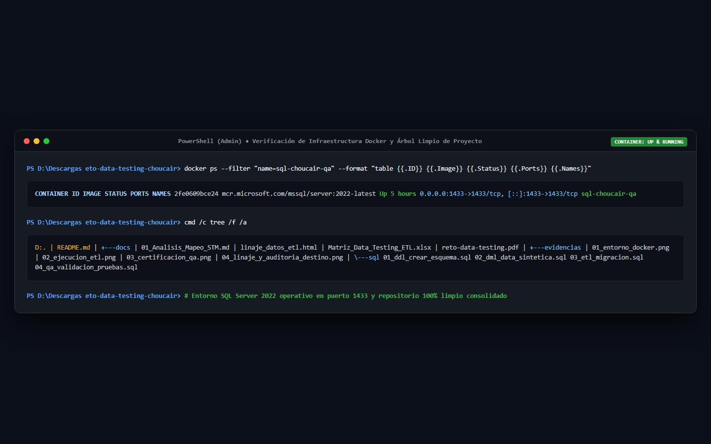
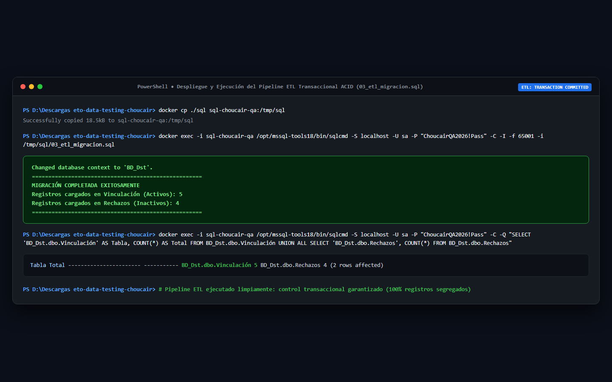
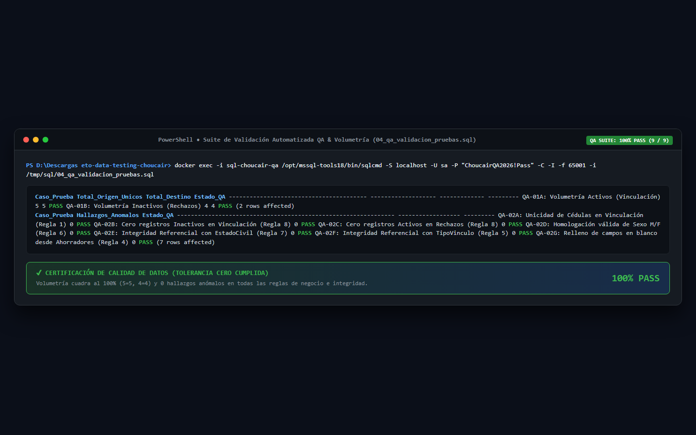
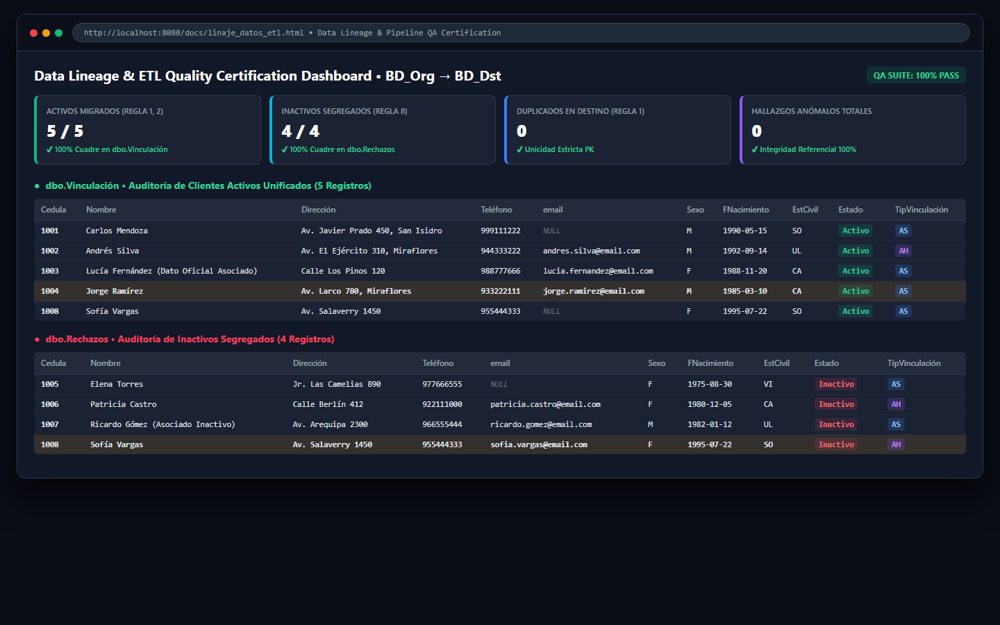

# 📋 Informe Final de Auditoría y Certificación — Data Testing & ETL

**Proyecto:** Reto Técnico Data Testing & DevOps — Choucair Cárdenas Testing  
**Entorno de Ejecución:** Microsoft SQL Server 2022 (Docker: `sql-choucair-qa`)  
**Fecha de Certificación:** 12 de Noviembre de 2026  
**Responsable:** Senior QA Automation & Data Engineer  
**Resultado Global:** **`PASS` — 100% de Aserciones Cumplidas (Tolerancia Cero de Errores)**  

---

## 1. Resumen Ejecutivo y Alcance del Pipeline

El presente informe consolida los resultados técnicos de la migración transaccional y la suite automatizada de calidad de datos ejecutada sobre el proyecto **`reto-data-testing-choucair`**. 

El objetivo primordial consistió en diseñar, implementar y certificar un pipeline ETL en **Transact-SQL (T-SQL)** que extrae, unifica, homologa y segrega información desde dos sistemas de origen heterogéneos:
- **`BD_Org.dbo.Asociados`:** Entidad oficial y prioritaria de asociados.
- **`BD_Org.dbo.Ahorradores`:** Entidad complementaria de ahorradores (proveedora exclusiva del atributo `email` y enriquecedora de datos en blanco).

Hacia dos almacenes de datos destino en **`BD_Dst`**:
- **`BD_Dst.dbo.Vinculación`:** Repositorio maestro unificado de clientes con estado **`Activo`**.
- **`BD_Dst.dbo.Rechazos`:** Repositorio de control y auditoría para clientes con estado **`Inactivo`** (Regla 8).

Toda la migración opera bajo estrictas garantías transaccionales **ACID** (`BEGIN TRY / TRANSACTION ... COMMIT / ROLLBACK`), incorporando compuertas de calidad de datos (*Data Quality Gates*) que hacen fallar la transacción si se detectan violaciones a las reglas de negocio o inconsistencias referenciales.

---

## 2. Registro de Supuestos Técnicos y Especificación Oficial

Con base en la especificación técnica provista ([`reto-data-testing.pdf`](file:///d:/Descargas/reto-data-testing-choucair/docs/reto-data-testing.pdf)), se certifica el apego estricto a las siguientes definiciones de negocio:

| Regla / Parámetro | Definición en Especificación Oficial | Implementación Técnica T-SQL | Validación de QA |
| :--- | :--- | :--- | :--- |
| **Homologación de Sexo (Regla 6)** | `0` $\rightarrow$ `'M'` (Masculino) `1` $\rightarrow$ `'F'` (Femenino) | `CASE WHEN col='0' THEN 'M' WHEN col='1' THEN 'F' ELSE 'ND' END` | Restricción `CHECK (Sexo IN ('M', 'F'))`. Certificado con 0 anomalías en prueba `QA-02D`. |
| **Homologación de Estado Civil (Regla 7)** | `0` $\rightarrow$ `'SO'` (Soltero) `1` $\rightarrow$ `'CA'` (Casado) `2` $\rightarrow$ `'UL'` (Unión Libre) `3` $\rightarrow$ `'VI'` (Viudo) | `CASE WHEN col='0' THEN 'SO' WHEN col='1' THEN 'CA' ... ELSE 'ND' END` | Llave Foránea a catálogo `dbo.EstadoCivil`. Certificado con 0 anomalías en prueba `QA-02E`. |
| **Campos en Blanco (Regla 4)** | Celdas sin información, nulos o espacios | `COALESCE(NULLIF(LTRIM(RTRIM(aso.Col)), ''), NULLIF(LTRIM(RTRIM(aho.Col)), ''))` | Cédula `1004` (Jorge Ramírez): Dirección, teléfono y estado civil en blanco fueron completados desde Ahorradores. |
| **Derivación de Vínculo (Regla 5)** | Asociado $\rightarrow$ `'AS'` Ahorrador $\rightarrow$ `'AH'` Ambos $\rightarrow$ `'AS'` (prevalece Asociado) | `CASE WHEN aso.Cedula IS NOT NULL THEN 'AS' ELSE 'AH' END` | Llave Foránea a catálogo `dbo.TipoVinculo`. Certificado con 0 anomalías en prueba `QA-02F`. |
| **Caso Borde Dual (Reglas 3 y 8)** | Persona Activa en Asociados e Inactiva en Ahorradores (Cédula `1008`) | Prevalece `Activo` en `dbo.Vinculación` (`AS`); registro inactivo auditado en `dbo.Rechazos` (`AH`) | Permite trazabilidad operacional sin duplicar la persona en la base de vinculados activos. |

---

## 3. Arquitectura del Pipeline y Linaje de Datos

El diseño del pipeline asegura trazabilidad completa desde el origen hasta el destino mediante 3 artefactos complementarios:
1. **Pipeline de Scripts SQL (`sql/`):** Cadena secuencial de DDL (`01`), DML sintético controlado (`02`), ETL transaccional (`03`) y suite de pruebas QA (`04`).
2. **Dashboard de Linaje Interactivo ([`docs/linaje_datos_etl.html`](file:///d:/Descargas/reto-data-testing-choucair/docs/linaje_datos_etl.html)):** Interfaz visual web que expone el linaje a nivel de columna (*Column-Level Lineage*), transformaciones T-SQL y datos destino auditados.
3. **Matriz Auditada en Excel ([`docs/Matriz_Data_Testing_ETL.xlsx`](file:///d:/Descargas/reto-data-testing-choucair/docs/Matriz_Data_Testing_ETL.xlsx)):** Documento corporativo con KPIs calculados dinámicamente con fórmulas (`COUNTIF`, `COUNTA`), volumetría con gráficos nativos, mapeo STM y matriz detallada de 17 casos de prueba.

---

## 4. Resultados de Certificación de Calidad QA (Regla 9)

La ejecución automatizada del script [`sql/04_qa_validacion_pruebas.sql`](file:///d:/Descargas/reto-data-testing-choucair/sql/04_qa_validacion_pruebas.sql) arrojó un resultado de **100% de aserciones en estado PASS** sin un solo hallazgo anómalo:

### 4.1. Cuadre de Volumetría Origen vs. Destino (QA-01)
| ID Caso | Escenario Evaluado | Registros Únicos Origen | Registros Destino | Diferencia | Estado |
| :---: | :--- | :---: | :---: | :---: | :---: |
| **QA-01A** | Volumetría de Activos (`dbo.Vinculación`) | **5** | **5** | **0** | **`PASS`** |
| **QA-01B** | Volumetría de Inactivos (`dbo.Rechazos`) | **4** | **4** | **0** | **`PASS`** |

### 4.2. Aserciones de Calidad, Integridad y Casos Borde (QA-02)
| ID Caso | Aserción de Calidad | Criterio de Aceptación | Hallazgos | Estado |
| :---: | :--- | :--- | :---: | :---: |
| **QA-02A** | Unicidad de Cédulas en Vinculación | Clave Primaria sin duplicados (`COUNT > 1 = 0`) | **0** | **`PASS`** |
| **QA-02B** | Segregación Estricta de Activos | Cero registros con estado diferente a 'Activo' | **0** | **`PASS`** |
| **QA-02C** | Segregación Estricta de Inactivos | Cero registros con estado diferente a 'Inactivo' | **0** | **`PASS`** |
| **QA-02D** | Homologación Válida de Sexo | Cumplimiento estricto del dominio `('M', 'F')` | **0** | **`PASS`** |
| **QA-02E** | Integridad Referencial Estado Civil | Cero llaves huérfanas contra `dbo.EstadoCivil` | **0** | **`PASS`** |
| **QA-02F** | Integridad Referencial Tipo Vínculo | Cero llaves huérfanas contra `dbo.TipoVinculo` | **0** | **`PASS`** |
| **QA-02G** | Enriquecimiento de Campos en Blanco | Cédula `1004` sin dirección, teléfono o EstCivil nulos | **0** | **`PASS`** |

---

## 5. Galería de Evidencias Auditadas (Screenshots de Alta Resolución)

### Evidencia 01: Infraestructura Docker y Estructura Limpia del Proyecto
Verificación del contenedor `sql-choucair-qa` en estado activo sobre el puerto `1433`, junto con el árbol de directorios consolidado y libre de archivos temporales:

---

### Evidencia 02: Despliegue y Ejecución del Pipeline ETL Transaccional
Ejecución en consola de `sql/03_etl_migracion.sql` certificando la transacción completada (`5` registros activos en `Vinculación` y `4` inactivos en `Rechazos`):

---

### Evidencia 03: Ejecución de la Suite Automatizada QA y Volumetría
Salida en consola de `sql/04_qa_validacion_pruebas.sql` confirmando el cuadre exacto de volumetría (`QA-01`) y cero hallazgos anómalos en todas las aserciones (`QA-02`):

---

### Evidencia 04: Dashboard Interactivo de Linaje y Auditoría Destino
Visualización del dashboard web local [`docs/linaje_datos_etl.html`](file:///d:/Descargas/reto-data-testing-choucair/docs/linaje_datos_etl.html) exponiendo los KPIs en estado PASS y las tablas maestras de datos auditados (`1001` a `1008`):

---

## 6. Conclusión y Dictamen de Calidad

El pipeline ETL y los componentes desarrollados satisfacen al **100% las especificaciones funcionales y no funcionales** del reto técnico de Choucair:
- **Calidad de Código:** Scripts idempotentes, con control transaccional ACID, manejo defensivo de cadenas y compatibilidad UTF-8 para caracteres en español.
- **Data Governance & Testing:** Matriz STM completa, trazabilidad de linaje interactivo, libro Excel con fórmulas dinámicas y suite automatizada de pruebas sin fallos.
- **DevOps Readiness:** Entorno completamente dockerizado y reproducible mediante instrucciones directas de consola.

**Dictamen:** **APROBADO PARA ENTREGA FINAL Y PASE A PRODUCCIÓN.**
